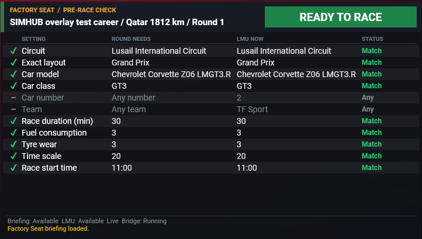
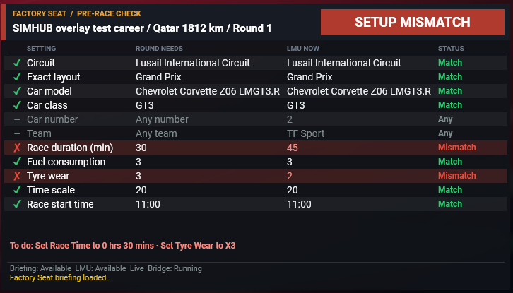

# Factory Seat Companion

A SimHub overlay for **Le Mans Ultimate** that tells you, before you start a race, whether LMU's race setup matches the round your [**Factory Seat**](https://github.com/factoryseatlmuapp/factory-seat) career expects. It reads the career's next round, reads LMU's current menu settings, and shows a checklist with one line per setting and a banner that reads **READY TO RACE** only when everything lines up.

It only reads. It never changes LMU's settings, never writes to Factory Seat or your career save, and its only game traffic is local HTTP reads from LMU on your own PC.

> **Status:** early. It has been run end to end on one PC; expect rough edges.

## Quick start

1. Install **SimHub** and **Factory Seat 1.1 or later**, and run LMU in windowed or borderless mode.
2. Exit SimHub, then run `FactorySeatCompanion-Setup-<version>.exe` ([download](#download)).
3. Start SimHub and enable **Factory Seat Companion** when it asks about the new plugin.
4. In **Dash Studio > Overlays**, set the layout's visibility to **Manual**, save the layout, and start **FactorySeatCompanion**.
5. Open your career in Factory Seat, start LMU, and set up the race until the overlay reads **READY TO RACE**.

The rest of this page explains each step and how to read the overlay.

## Requirements

- Windows 10 or 11 (64-bit).
- **Le Mans Ultimate** in windowed or borderless mode. SimHub overlays cannot draw over exclusive fullscreen.
- **SimHub** (tested with 9.13.2).
- [**Factory Seat**](https://github.com/factoryseatlmuapp/factory-seat) **1.1 or later**, which writes the open career's next round to `%AppData%\LmuCareer\briefing.json`. Earlier versions don't write this file, so the overlay stays at NOT VERIFIED. The format is described in [docs/briefing.md](docs/briefing.md).

You don't need .NET or any developer tools: the installer brings everything the companion needs.

## Download

Download `FactorySeatCompanion-Setup-<version>.exe` (installer) or `FactorySeatCompanion-<version>.zip` (the same files to copy by hand) from the [Releases page](https://github.com/Milky28/factory-seat-companion/releases).

Until a release is published, both are attached to each run of the [Player package workflow](https://github.com/Milky28/factory-seat-companion/actions/workflows/package.yml): open the latest green run, scroll to **Artifacts** and download **FactorySeatCompanion-player** (GitHub asks you to sign in).

## Install

1. **Exit SimHub** from its tray icon (right-click, Exit).
2. **Run the installer.** It finds your SimHub folder and installs:
   - the plugin, `FactorySeatCompanion.SimHub.dll`;
   - its companion program, in `SimHub\FactorySeatCompanion\`;
   - a ready settings file, `SimHub\FactorySeatCompanion\companion.json`;
   - the overlay, in `SimHub\DashTemplates\FactorySeatCompanion\`.

   If SimHub lives somewhere unusual, pick the folder that contains `SimHubWPF.exe` when asked. If SimHub is still running, the installer asks you to exit it first.

   **Using the zip instead:** extract it into your SimHub folder (usually `C:\Program Files (x86)\SimHub\`) and let Windows merge the `FactorySeatCompanion` and `DashTemplates` folders.
3. **Start SimHub** and enable **Factory Seat Companion** when SimHub asks about the new plugin.
4. **Set the overlay to Manual visibility.** SimHub's default, "Automatic (Show when game is connected)", hides overlays in LMU's menus because LMU sends no car data there, so the checklist would never appear on race setup. Open **Dash Studio**, go to **Overlays**, open the layout settings, set **Layout automatic visibility** to **Manual** and click **Save layout**. If you start the overlay on its own rather than in a layout, set its visibility to **Manual** instead. The overlay still hides itself while you drive or load (see [When the overlay shows](#when-the-overlay-shows)).
5. **Start the overlay.** In **Overlays**, start **FactorySeatCompanion** and move it where you want it over LMU's menus.

**Updating:** exit SimHub and run the newer installer. Your own settings (see [Settings](#settings)) are kept.

**Uninstalling:** uninstall **Factory Seat Companion (SimHub plugin)** from Windows' **Installed apps**. Only the companion's files are removed.

## Using it

1. **Open your career in Factory Seat** and leave Factory Seat running. That's how the companion knows the briefing is current.
2. **Start LMU** and set up the race in its single-player menus.
3. **Watch the overlay** while you change settings. Each row updates within a couple of seconds. Fix every red row; when every row is green or grey, the banner turns green and reads **READY TO RACE**.

In this example the round needs a 30-minute race and tyre wear 3, but LMU is set to 45 minutes and tyre wear 2. The **To do:** line says what to change in LMU's own wording.

### When the overlay shows

The overlay shows while you're in LMU's menus and hides as soon as an event starts loading. It stays hidden in the garage, while driving, in the pause menu and in replays, and comes back when you return to the menus. LMU can't tell the companion whether you're on the main menu or on race setup, so it shows on both.

To hide it on the main menu, bind a key or wheel button to it. In SimHub, open **Controls and events**, add a new mapping, press the button you want, and pick the action **FactorySeatPlugin.ToggleOverlay**. Pressing it hides the overlay until your next session, and pressing it again brings it back. The overlay stays hidden until LMU is running. If LMU is running but its data can't be read, the overlay stays up so you can still see which settings the round needs.

## What it checks

| Row | Compared against |
| --- | --- |
| Circuit and exact layout | The round's track and layout |
| Car model, class, number and team | The round's car (number and team only when the round sets them) |
| Race duration | The round's race length, when LMU's race finish is **Time**; otherwise a reminder to set it by hand (see [Known limits](#known-limits)) |
| Fuel consumption, tyre wear, time scale | The round's multipliers |
| Race start time | The round's start time, or LMU's default |

A "Custom team identity" row appears when the round uses a Race Control custom team.

## Reading the overlay

The top banner sums everything up:

| Banner | Meaning |
| --- | --- |
| **READY TO RACE** (green) | Every row matches or doesn't apply, and the data is fresh. |
| **SETUP MISMATCH** (red) | At least one LMU setting differs from the round. Fix the red rows. |
| **NOT VERIFIED** (amber) | Something can't be confirmed: a row is unknown, LMU or the briefing isn't readable, or the data is out of date. |

Next to the banner is the career, event and round, then one row per check showing what the round needs and what LMU currently has. Each row starts with a mark and is coloured by its status:

| Mark | Status | Meaning |
| --- | --- | --- |
| ✓ green | Match | LMU has what the round requires. |
| ✗ red | Mismatch | LMU has a different value. The row is highlighted, and the **To do:** line says what to change, such as "Set Tyre Wear to X3". |
| ○ amber | Unknown | The value couldn't be read or confirmed. This blocks READY TO RACE. |
| – grey | Any | The round doesn't restrict this setting, such as any car number. |
| ☐ blue | Check | LMU isn't reporting this value yet, so set it by hand. It doesn't block READY TO RACE. |

If LMU can't be read (for example after a game update breaks its API), every row shows ○ with the round's value still listed, and an amber note under the rows says to check each setting in LMU's menu by hand. The overlay then works as a plain checklist.

The footer shows where the data comes from. **Briefing** and **LMU** say whether each source is readable (`Available`, `Unavailable`, `Stale`, `Invalid` or `UnsafeState`). **Bridge** says whether the plugin's companion program is running. Any problem the checker found appears as a message at the bottom.

## Troubleshooting

| What you see | What to do |
| --- | --- |
| The overlay never appears in LMU's menus | Set the overlay layout's visibility to **Manual** (Install step 4), and check you haven't hidden it with the toggle. |
| **Briefing Stale** | Factory Seat is closed, or you've left the career. Reopen it. |
| **Briefing Unavailable** | Factory Seat hasn't written a briefing (version older than 1.1), or the career is between seasons. |
| **LMU Unavailable** | LMU isn't running, or isn't answering on its local port yet. |
| **LMU UnsafeState** | You're driving, in a replay or loading. Checks resume in the menus. If it never clears in the menus, check that your settings still have `"safeSetupStates": ["GSTATE_SETUP"]`. |
| **Exact layout Unknown** | The companion doesn't know how this layout is named in LMU yet. See [Known limits](#known-limits). |
| **Bridge** says the companion CLI wasn't found | Reinstall; the companion program is missing from `SimHub\FactorySeatCompanion\`. |

## Settings

The installed settings work as they are. To change them (for example to add a layout mapping), copy `SimHub\FactorySeatCompanion\companion.json` to `%AppData%\FactorySeatCompanion\companion.json` and edit that copy. It takes precedence over the installed file, and updates never overwrite it. Restart SimHub afterwards.

The installed settings let the checks run while you're in LMU's menus (`"safeSetupStates": ["GSTATE_SETUP"]`) and pause them while you drive, watch a replay or load. Other plugin options are described in [docs/simhub-plugin.md](docs/simhub-plugin.md#settings).

## Known limits

- **Race duration in "% Track Time" mode is checked by hand.** In that mode LMU doesn't report a Race Time change until the hours change or the session starts. The row shows ☐ Check, and the **To do:** line reminds you to set the Race Time, for example "Set Race Time to 0 hrs 30 mins (change the hours once so LMU confirms it)". Changing the hours switches LMU to Time mode, and the row is then compared normally.
- **Layouts need a mapping.** LMU and Factory Seat name layouts differently, and only Bahrain (Endurance and Outer) and Lusail ship in the installed settings. Any other layout shows Unknown. To add one, select the layout in LMU: the message at the bottom of the overlay then reads "No layout mapping for trackFolder …, sceneDescription …". Add both values with the round's `layoutFile` (from `briefing.json`) to `layoutMappings` in your own settings file (see [Settings](#settings)) and restart SimHub.
- **Custom teams** can't be confirmed through LMU's API, so a round with a Race Control custom team always stays NOT VERIFIED.
- **Main menu and race setup look the same to the API.** With `GSTATE_SETUP` allowed, checks also run on LMU's main menu, and the overlay shows there too. That's harmless because LMU's own menus read the same data there. Use the toggle in [When the overlay shows](#when-the-overlay-shows) to hide it.
- **Overlay size.** SimHub refuses to start overlays above an undocumented size, so the overlay is fixed at 720×406.
- LMU's local API is unofficial and undocumented. A game update can change it and break checks, which show as Unknown rather than a false match.

## For developers

Building from source, testing, the diagnostic CLI and the live LMU test procedure are in [docs/development.md](docs/development.md). Building the installer and zip is in [docs/installer.md](docs/installer.md). See also the [SimHub plugin internals](docs/simhub-plugin.md), [briefing format](docs/briefing.md), [architecture](docs/architecture.md) and [research notes](docs/research.md).

## License

[MIT](LICENSE)
