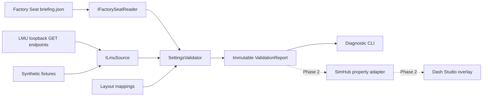

# Architecture and implementation plan

## Phase 1 plan and delivered components

1. Examine the empty workspace, Factory Seat models/briefing UI/catalog, reported LMU endpoints, and installed SimHub SDK. Record provenance and unresolved assumptions.
2. Implement nullable requirements and observations, an isolated briefing file adapter, guarded HTTP GET transport, and independent comparisons. Missing data must not become defaults.
3. Exercise complete/missing/mismatched observations, identity policies, schema/freshness failures, replay transitions, file changes, and transport recovery in automated tests. Provide a fixture demo and live CLI.
4. Document the final-contract adaptation point, live acceptance, and SimHub integration approach. Defer plugin/dashboard and in-race features to their phases.

All four Phase 1 items are delivered; live game acceptance is outstanding because LMU was not serving its API during development.

## Component boundaries

- **Core/Models.cs**: development DTO, nullable observations, source health, per-field status, report, and configuration. No SimHub references.
- **IFactorySeatReader / FactorySeatBriefingReader**: open input read-only with read/write/delete sharing, bound the read to 1 MiB, reject duplicate properties/unsupported versions, treat a closed career (`open: false`) or a missing `FactorySeat` process as stale, check round state, reread after each game poll. Invalid/partial/deleted files revoke earlier evidence. See [briefing.md](briefing.md).
- **ILmuSource / LmuApiClient**: use a caller-owned HttpClient and cancellation; only fixed loopback GETs, bounded 2 MiB bodies, per-request timeout. No caches or write endpoints. CLI disables redirects and proxy use. Request failures produce diagnostics; a subsequent poll retries normally. Do not supply a redirect-enabled handler when hosting the client elsewhere.
- **NavigationPolicy**: exact configured JSON pointer and state allowlist, empty by default. Detect replay strings/flags and loading flags, including JSON strings inside `loadingData`. Deny malformed/ambiguous navigation. Navigation is checked before other reads, just before the garage endpoint, and afterward; a state change discards that cycle.
- **LmuJsonParser / Normalization**: parse endpoints independently. Unique keyed settings or unique `name`/`id` setting records may appear in wrappers; unsupported or repeated values stay unknown. Setup expects the documented `trackInfo`/`selectedCar` envelope and durations the `scheduledSessions` envelope. Vehicle folder comes from the `Installed/Vehicles` path segment. Class matching uses full tokens, never substrings. Unknown shapes can be adapted after captures without changing validation rules.
- **SettingsValidator**: compares identifiers with trimmed ordinal case-insensitive equality; numbers with a 0.001 absolute tolerance; times at minute precision; car numbers as exact strings after optional `#` removal. Layout requires a unique `(cmpName, sceneDesc)` mapping. Reports distinguish source health from per-field comparison. Any noncurrent global source state clears all automatic matches.
- **CLI**: connects these components, emits text or structured JSON, delays after each cycle, and handles Ctrl+C. Observations carry cycle-start timestamps, so a slow request sequence does not appear freshly observed at completion. Readiness is a timestamped observation, not a guarantee that LMU has not changed since it was sampled.

The briefing holds the *effective* round car. Guest substitution and season/contract rules belong in Factory Seat's export, not in LMU parsing. A per-event output from Factory Seat avoids independently reverse-engineering career saves or career progression.

## Reliability decisions

Do not keep last-known live values after an endpoint fails, or last-known requirements after a briefing fails. If one LMU endpoint fails, other current fields can still compare, but unknown mandatory fields prevent readiness. Missing `customTeam`, omission policies, or unresolved custom-team evidence cannot be silently treated as unrestricted.

Readable `stringValue` is authoritative for the four settings for now. `currentValue` is preserved only in raw fixtures and is not assumed to be a physical multiplier or time. Capture the real numeric encoding before allowing numeric-only responses. The sessions response's race-time percentage is never a fallback duration.

No endpoint offers an atomic event snapshot. Conservative navigation gating reduces replay exposure but cannot prevent a game state change between a successful gate and the next request. Similarly, distinct reads can observe setting changes within a cycle. Validate against actual captures before claiming live compatibility, and use observation timestamps in the future overlay.

## Next phases

**Phase 2**: confirm actual navigation routes; import captured JSON fixtures; adapt the creator's real versioned contract; build a .NET Framework 4.8 SimHub SDK plugin that publishes immutable reports as custom properties. Keep disk/network work off `DataUpdate`. Decide between compatible core targeting and a local process bridge after a small runtime compatibility spike. Build/export a real Dash Studio dashboard and test pre-race visibility in LMU windowed and borderless modes, including “waiting for telemetry” behavior.

**Phase 3**: installer/configuration UI, briefing location discovery, clear connection diagnostics, dashboard import instructions, and packaged Windows release. Do not install or enable speculative plugins automatically.

**Future**: the report/model boundaries can accept pit/stint plans and objectives later. No results ingestion, save writes, setting writes, or full telemetry work is implemented.
